# 1.CNN 的演进先沿着深度推进


> 早期 CNN 语义层层组合，网络越深，能表达的视觉概念通常越复杂。

## 但继续加深之后，反常现象出现了

如果网络越深越好，那么把层数从几十层堆叠到上百层，训练误差至少不应该变差。ResNet 论文在 CIFAR-10 上比较了 20 层和 56 层普通网络。结果显示：*更深的网络不只是测试集效果下降，连训练集误差也更高*。

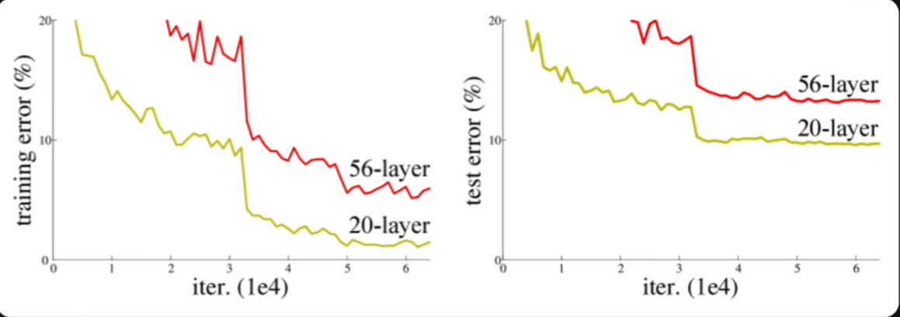

> 问题不出在泛化，而在优化本身！

## 退化不是过拟合，而是优化问题

过拟合的典型特征是训练误差很低，测试误差很高，模型把训练集背得很熟，泛化很差。而深度网络的退化不同：网络连训练集误差都降不下去。

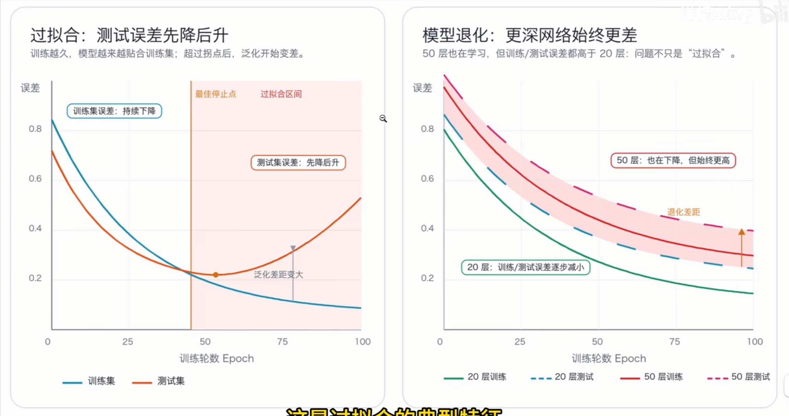

> 深层网络更难被训练到一个好的解，这个现象叫做**退化**（degradation)。

## 深网络至少不应该更差：恒等映射的悖论


> 理论上能表示，不等于优化器能找到。

## 为什么“什么都不做”反而很难学？

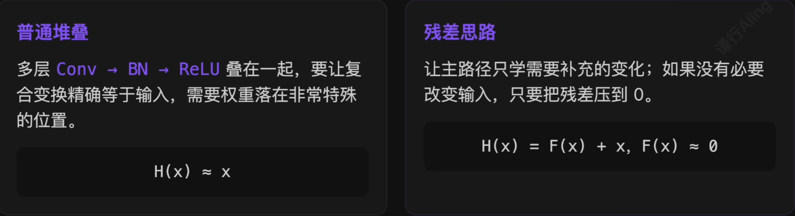

把一组卷积层的权重学到接近 0，通常比让它们精确学出恒等映射容易得多。

# 2.ResNet 的突破：让深层网络重新可训练

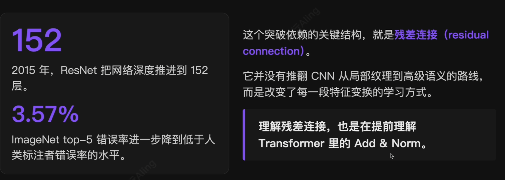

## 残差：还没有解释掉的那一部分

在回归问题里，残差的含义非常明确：真实值里还没有被当前模型解释掉的部分。

$$
r = y - \hat{y}
$$

Boosting 方法也体现了这种思想：新加入的模型不必一次解决全部问题，而是一级一级地补当前还没解释好的部分。

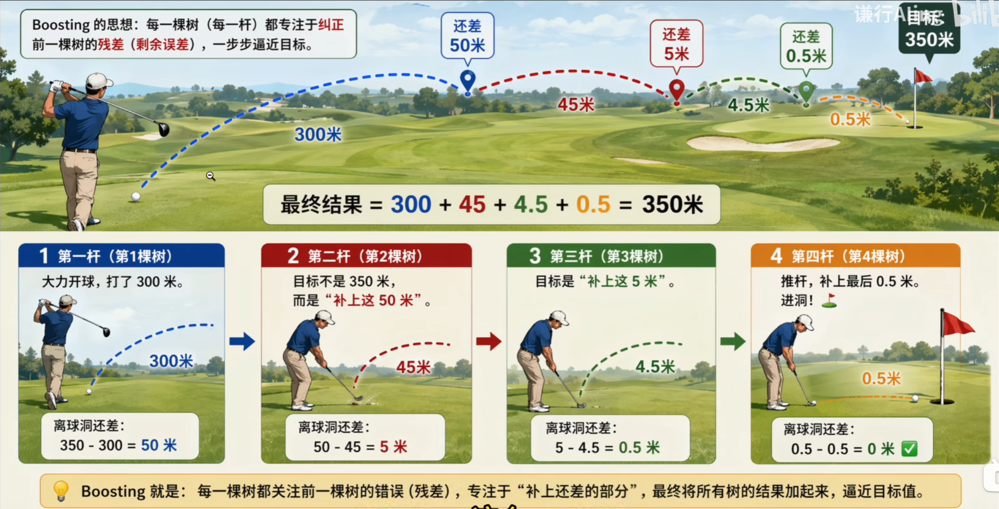

## 加性建模：不要一步到位，而是逐步修正

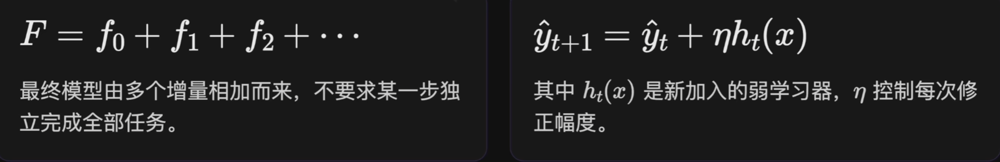

> 残差连接把这种“在已有结果上做修正”的思想搬进了深层 CNN。

## CNN 里的残差：对特征图的修正量

与其让一组层直接学习目标映射 $H(x)$，不如让它只学习输入基础上还需要补多少。

$$
\begin{align}
H(x)=F(x)+x \\
F(x)=H(x)-x
\end{align}
$$

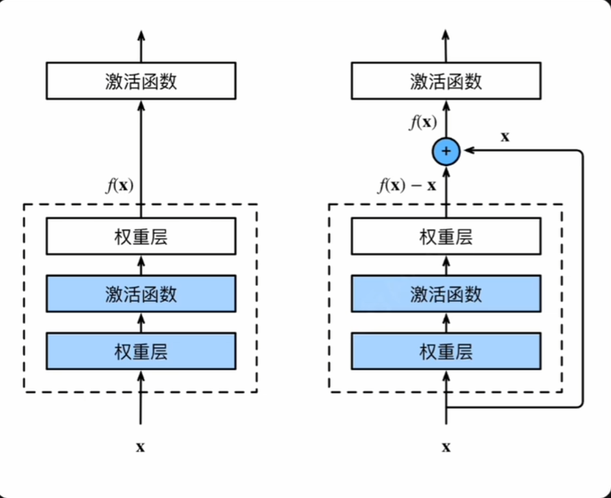

> 主路径学习残差映射 $F(x)$，跳跃连接把输入 $x$ 原样送到输出处相加。

### 这里的 x 不是一个数，而是一整张特征图

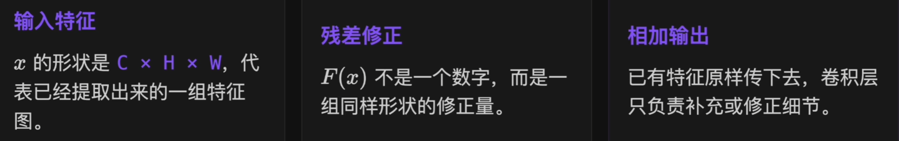

当这层不需要做任何事情时，只要让 $F(x)$ 接近 0，输出就自动等于输入 $x$。

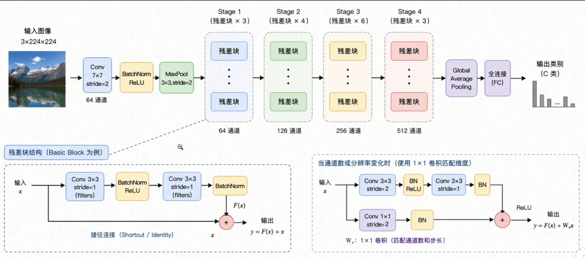

输入图像先经过 Stem 转成初始特征图，随后进入多个 Stage。每个 Stage 内堆叠残差块；Stage 之间空间尺寸逐步变小，通道数逐步变多。

> ResNet 不是等宽长链，而是带有尺度变化节奏的 CNN 主干。

## Stage 决定尺度，残差块负责修正

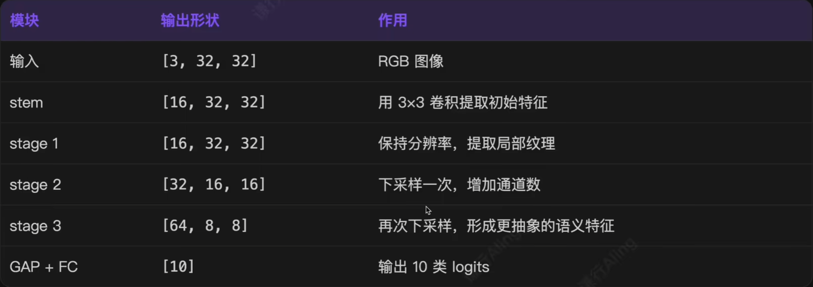

浅层保留边缘、颜色和纹理；越往后，空间尺寸降低，感受野变大，通道表达更多语义模式。

# 3.步骤细讲

## Stem：把像素转换成初始特征图

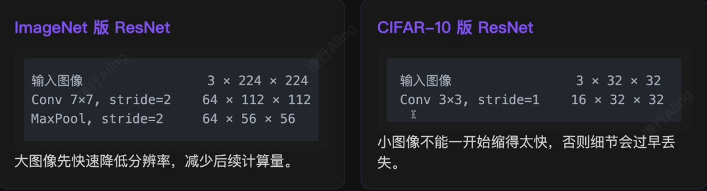

## BasicBlock：最容易理解的残差块

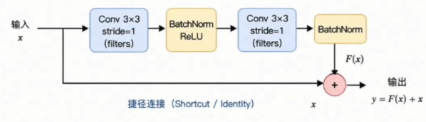

```
x                     C × H × W
Conv 3×3, BN, ReLU    C × H × W
Conv 3×3, BN          C × H × W
+ x (skip)            C × H × W
ReLU                  C × H × W
```

同一个 Stage 内部，输入输出形状通常相同，所以 Shortcut 可以直接做恒等相加。

***Notes.ipynb 单元15：BasicBlock 的 PyTorch 实现**

## 进入新 Stage 时，需要投影 Shortcut

新 Stage 的第一个残差块通常让空间尺寸减半、通道数增加。此时输入和主路径输出无法直接相加。

主路径第一个 `3×3` 卷积使用 `stride = 2`；shortcut 分支也用 `1×1` 卷积、 `stride = 2` 对齐形状。

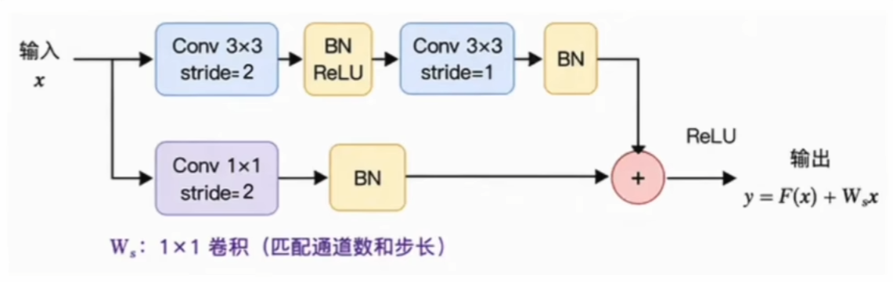

$$
H(x) = F(x) + W_sx
$$

## Bottleneck：更深 ResNet 的计算控制

ResNet-50、101、152 更深，如果每个残差块仍使用两个完整的 3×3 卷积，计算量会非常大。怎么办呢？

1. 1×1 卷积    降通道
2. 3×3 卷积    处理空间领域
3. 1×1 卷积    升通道

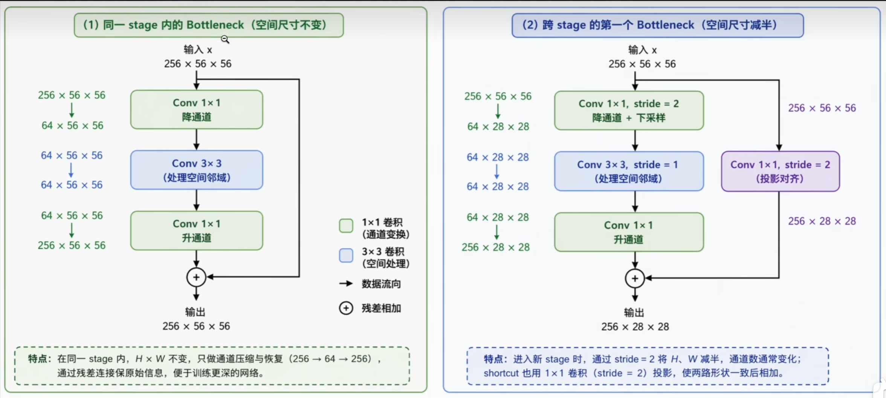

Bottleneck 降的是中间通道，不是默认降分辨率。

### 两类残差块

| 残差块        | 主路径             | 常见网络                  |
| ---------- | --------------- | --------------------- |
| BasicBlock | 3×3 → 3×3       | ResNet-18 / 34        |
| Bottleneck | 1×1 → 3×3 → 1×1 | ResNet-50 / 101 / 152 |

只有进入新 stage 的第一个 Bottleneck 才会通过 `stride = 2` 改变空间尺寸。

## Global Average Pooling

经过多个 stage 后，ResNet 最后一个 stage 会输出一组高层特征图。GAP 层把这组特征图逐通道压缩。

$$
\begin{align}
[C, H, W] \rightarrow [C, 1, 1] \rightarrow [C] \\
Z_c = \frac{1}{HW}\sum_{i,j}x_{c,i,j}
\end{align}
$$

- **逐通道求平均**：第 $c$ 个通道的 $H×W$ 个位置，被平均成 1 个数字；
- **特征图变成向量**：$C$ 张特征图最终变成长度为 $C$ 的分类向量。

> GAP 的核心作用：把最后一个 stage 输出的 $C$ 张特征图逐通道从 $H×W$ 压缩。

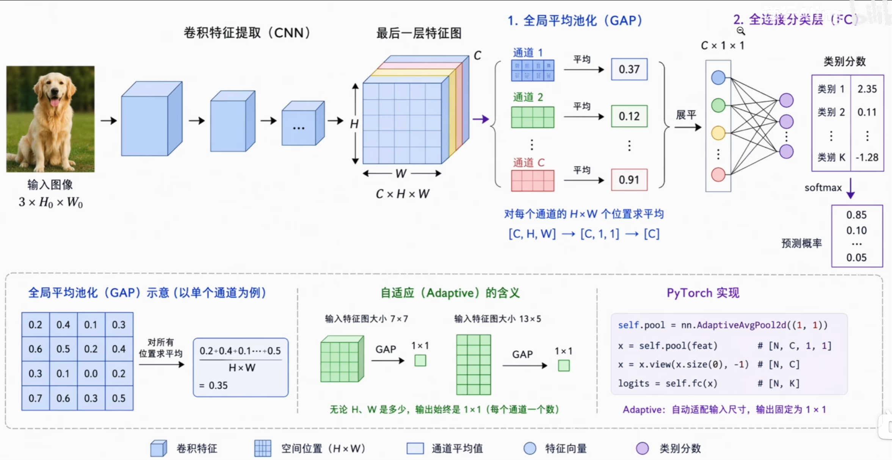

# 4.把残差块放进 CIFAR-10 训练流程

**为什么是 CIFAR ResNet？**

CIFAR-10 图像只有 32×32，开头不适合使用 ImageNet ResNet 那种大卷积和最大池化，否则空间信息会过早丢失。

**核心改动**：开头只用一层 3×3 卷积，随后一次堆叠 16→32→64 三个通道阶段。

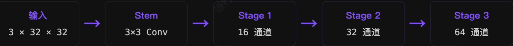

> 每次进入新阶段时使用 `stride = 2` 下采样；形状变化时用 1×1 shortcut 投影对齐。

**训练设置**：

- 随机裁剪 + 水平翻转
- SGD + momentum
- weight decay 正则化
- MultiStep 学习率衰减

- ***Notes.ipynb 单元16：CifarResNet 主体***
- ***Notes.ipynb 单元17：训练与评估函数***
- ***Notes.ipynb 单元18：主函数***

**代码和架构分析一一对应，主路径负责学习修正量，跳跃连接负责保留已有信息。网络因此可以放心继续加深。**

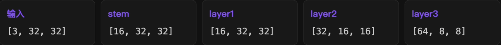

# 5.残差连接已经超越 CNN

## CNN 架构继续演进

- ResNeXt：残差块里加入分组卷积
- DenseNet：用拼接让浅层特征反复复用
- SENet：在残差块中加入通道注意力
- ConvNeXt：保留卷积主干，吸收 Transformer 时代设计

## 深层网络的通用组件

Transformer 在每一个子层外面都套了一圈残差连接，并配合归一化一起使用。

$$
Add \quad \& \quad Norm
$$

残差连接让训练数百甚至上千层的网络成为可能。

## 一条捷径，改变了深度学习的默认结构

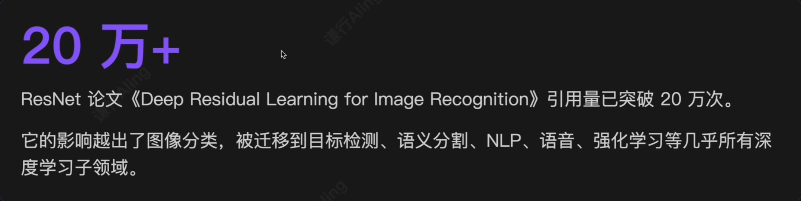

> 残差连接不再只是一个 CNN 技巧，而是深层网络的标准组件。

# 6.总结：残差连接到底解决了什么

- **退化问题**：一味加深层数会触发网络退化，网络连训练误差都更高；
- **学习增量**：残差连接把目标从学习完整映射 $H(x)$ 改成学习增量 $F(x)=H(x)-x$；
- **特征修正**：在 CNN 里，$x$ 是特征图，$F(x)$ 是对输入特征图的修正量；
- **架构节奏**：ResNet 用 stem, stage, 残差块和全局平均池化组成可训练的深层 CNN 主干。

> 把残差连接压缩成一句话：让网络去学在已有基础上的增量，而不是从零开始的全部。

